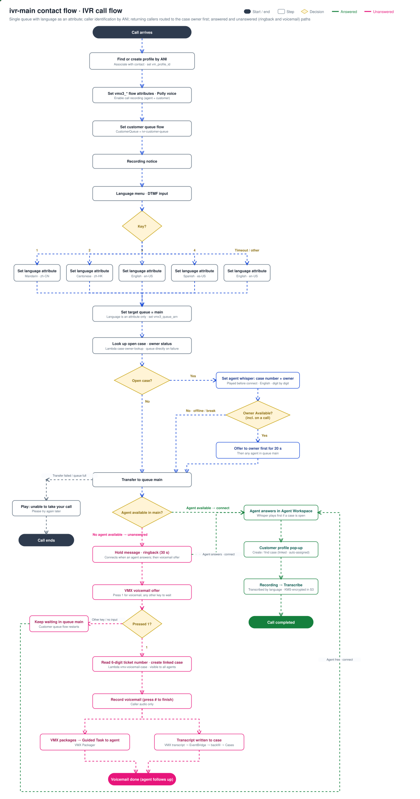

# Multilingual IVR Contact Center on Amazon Connect

**🌐 Language / 语言:** **English** · [简体中文](README.zh-CN.md)

> 📖 **[Deployment and operations guide →](docs/operations-manual.md)**: step-by-step instructions from deployment to end-to-end verification, including troubleshooting and cleanup.

This sample builds a multilingual, multi-role phone contact center on **Amazon Connect**. It covers caller identification with customer profile pop-up, case management with per-agent isolation, returning-caller routing to the case owner, supervisor monitoring and case assignment, and voicemail-to-case. The core capabilities use native Amazon Connect features; AWS Lambda and the Voicemail Express (VMX) solution add returning-caller routing, automatic case assignment and voicemail processing.

> **Note:** This is sample code for demonstration and evaluation. It is not hardened for production use. Deploying it creates billable resources (a phone number, call minutes, transcription and more); delete them when you are done (see section 7).

When a call arrives, **Amazon Polly** plays a greeting and a language menu (Mandarin / Cantonese / English / Spanish). The selected language is stored only as a contact **attribute** (it selects the transcription language and labels the contact for the agent); it does not select a queue. Every call goes to a **single queue, `main`**, and is answered first come, first served.

> **Language and prompts:** All system prompts (menu, hold message, voicemail prompts and the agent whisper) use the English Polly voice Joanna, regardless of the selected language. The selected language sets the Amazon Transcribe language and is shown to the agent. The ringback tone is the China-standard tone (450 Hz, 1 s on, 4 s off). To use another cadence, change the frequency and timing parameters of `_ringback_wav` in `lambdas/cfn_connect_helper/handler.py` and redeploy.

- **Answered calls:** `ivr-main` matches the caller's number (ANI) to a profile in **Amazon Connect Customer Profiles**, creating one if none exists, and associates it with the contact. The agent answers in the **Agent Workspace**, the customer profile opens automatically, and the agent can create or look up cases (**Amazon Connect Cases**) for the caller; a new case is assigned to the agent who created it. Calls are recorded and transcribed by **Amazon Transcribe** in the selected language; recordings and transcripts are stored in **Amazon S3**, encrypted with AWS KMS.
- **Returning callers:** Before queuing, the Lambda function `case-owner-lookup` looks up the caller's most recently updated open case. If one exists, the answering agent hears an **agent whisper** with the case number and owner before the call connects. If the owner is in the Available status (including while on a call), the call is **offered to the owner first for 20 seconds** and then to any agent in the queue.
- **Unanswered calls:** While waiting, the caller hears a hold message and a **ringback tone (about 30 seconds)**; if an agent becomes available the call connects immediately. If no agent answers, the caller is offered **voicemail (press 1)**. Before recording, the system reads out a **unique 6-digit ticket number**, and the Lambda function `vmx-voicemail-case` creates a case linked to the caller's profile. VMX transcribes the voicemail (caller audio only); when the transcript lands in the VMX transcripts bucket, **Amazon EventBridge** invokes `vmx-voicemail-transcript-backfill`, which writes it into the case. The voicemail is also delivered to agents as a **Guided Task**.
- **Case ownership:** Agents see only the cases assigned to them, plus unclaimed voicemail cases, which are visible to all agents. Cases without an owner (historical data) are visible to the supervisor only. The Lambda function `cases-auto-assign` subscribes to Cases events, fills in the assignee and keeps the `Owner` tag in sync; tag-based access control in the security profiles enforces the isolation.
- **Supervisor:** A separate `supervisor` user with a supervisor security profile can view **real-time metrics**, **monitor** and **barge in** on live calls, see all cases, and **assign or reassign** any case to any agent.

The whole system is deployed with **one AWS CDK stack** (default Region us-east-1). The deployment claims a US DID phone number and associates it with the inbound flow. See the [deployment and operations guide](docs/operations-manual.md) for the steps.

## Architecture


### IVR call flow

The diagram below shows the complete call logic: inbound call, ANI identification, language selection, returning-caller routing, the answered path (profile pop-up and cases) and the unanswered path (ringback and voicemail-to-case).



Path details:

- **Caller identification (shared by all paths):** `ivr-main` first runs `GetCustomerProfile` with `_phone` (the ANI); if no profile matches, it runs `CreateCustomerProfile`. It then runs `AssociateContactToCustomerProfile` and stores the profile ID in the contact attribute `vm_profile_id`. Profile pop-up, linking cases to the customer, and returning-caller routing all depend on this step.
- **Routing (single queue):** The language menu only sets contact attributes (`language`, `vmx3_lang`); all four branches set the target queue to `main`. All agents share the routing profile `agent-rp` (VOICE and TASK concurrency 1 each), and contacts go to the agent who has been idle longest.
- **Returning-caller routing:** After setting the queue, the flow calls `case-owner-lookup`, which uses `vm_profile_id` to find the caller's most recently updated open case and its owner's current status. If an open case exists, the flow sets the agent whisper flow `agent-whisper-case-notice` (English, case number read digit by digit). If the owner is Available, `UpdateContactRoutingCriteria` applies routing criteria that match only the owner and expire after 20 seconds, after which normal queue routing resumes. If the owner is offline or in any other status, there is no wait. If the Lambda call fails, the call goes straight to the queue.
- **Answered-call recording and transcription:** Recordings of answered calls are stored in S3, transcribed by Transcribe in the selected language, and written under the `transcripts/` prefix (KMS-encrypted).
- **Voicemail path (unanswered):** The customer queue flow `ivr-customer-queue` plays the hold message and ringback (30 s) → no agent answers → caller presses 1 → `vmx-voicemail-case` (generates the 6-digit ticket number, creates the case, links it to the profile by `vm_profile_id` or ANI) → the recording is stored in S3 → `vmx_fasttrigger` hands it to VMX → VMX transcribes it (caller audio only) → EventBridge (object created in the VMX transcripts bucket) → `vmx-voicemail-transcript-backfill` writes the transcript into the case; VMX also delivers a Guided Task to agents.
- **Case ownership:** The Cases domain streams events to EventBridge → automatic assignment rule (`CASE.CREATED` / `CASE.UPDATED`) → `cases-auto-assign`. On creation it fills in the assigned queue and the assignee (the creating agent). When the assignee changes it sets the `Owner` tag to the new agent's user name. When a case is unassigned, a voicemail case returns to the shared pool (`Owner=pool`) and any other case loses the tag (supervisor only).
- **Supporting services:** Polly provides text-to-speech for the flows; CloudWatch collects contact flow logs; Secrets Manager stores user passwords; KMS encrypts recordings and transcripts in the media bucket; the media bucket's server access logs go to a separate access log bucket.

---

## 1. Components

The CDK stack creates all resources. Deployment parameters (instance alias, agents, supervisor, phone number and so on) are set in `cdk/cdk.json`.

| Category | Resources |
|---|---|
| Encryption and storage | KMS customer managed key (automatic rotation); S3 media bucket (recordings and transcripts; KMS-encrypted; moves to S3 Standard-IA after 30 days and expires after 7 years); S3 prompts bucket; S3 access log bucket (SSE-S3, 1-year retention) |
| Amazon Connect | Instance; recording storage and contact record stream (Kinesis Data Streams); hours of operation `always-open`; queues `main` and `case-assignment` (lists agents for case assignment, receives no contacts); routing profiles `agent-rp` (agents, VOICE and TASK concurrency 1 each) and `supervisor-rp` (supervisor, receives no calls); security profiles `Agent-<username>`, `Agent-voicemail-pool` and `Supervisor`; agent and supervisor users (passwords generated by Secrets Manager); quick connects; ringback prompt `Ringback_CN_450`; contact flows `ivr-main`, `ivr-customer-queue` and `agent-whisper-case-notice`; phone number |
| Customer Profiles | Domain `amazon-connect-<instance-alias>` (CTR object type mapping, de-duplicated on `_phone`) and its integration with the instance. The `amazon-connect-` prefix lets the Amazon Connect service-linked role access the domain, which the Agent Workspace requires |
| Cases | Domain `<instance-alias>-cases`; ticket number and voicemail transcript fields; layout; standard and voicemail templates (the voicemail template propagates `Owner=pool`) and one template per agent (propagates `Owner=<username>`); event stream (including `created_by`, `assigned_user` and `assigned_queue`); association with the instance. Display names are set by `cases_labels` |
| Lambda | Call transcription `transcribe_trigger`; voicemail case `vmx_voicemail_case`; voicemail transcript backfill `vmx_voicemail_transcript_backfill`; returning-caller routing `case_owner_lookup`; case assignment `cases_auto_assign`; voicemail fast trigger `vmx_fasttrigger`; deployment helper `cfn_connect_helper` |
| EventBridge | Voicemail transcript backfill (object created in the VMX transcripts bucket); voicemail fast trigger (object created in the media bucket); case assignment (Cases events) |
| Voicemail Express | The official **[amazon-connect/voicemail-express-amazon-connect](https://github.com/amazon-connect/voicemail-express-amazon-connect)** V3 template, deployed as a nested stack. The stack grants its processing roles KMS decrypt access and disables its default Kinesis trigger (voicemail is processed from S3 events instead) |

Settings that CloudFormation does not support (Cases–instance association, the Cases event stream, template tag propagation, quick connect–queue association, phone number–flow association, looking up VMX flows by name, and generating the ringback prompt) are applied with CDK custom resources.

At synthesis, **cdk-nag** (AwsSolutions rule pack) runs security and compliance checks; synthesis fails on any finding that has not been reviewed. Reviewed and accepted findings, with their reasons, are recorded in `ConnectIvrStack._acknowledge_nag_findings`.

---

## 2. Deployment

Prerequisites: Node.js 20, 22 or 24 and the AWS CDK CLI; Python 3.11 or later; AWS credentials that can bootstrap CDK and deploy through the CDK bootstrap roles (see section 1.1 of the [deployment and operations guide](docs/operations-manual.md) for the least-privilege setup). Set a globally unique `instance_alias` in `cdk/cdk.json`, adjust the agent list if needed, and run:

```bash
cd cdk
python3 -m venv .venv && . .venv/bin/activate
pip install -r requirements.txt
cdk bootstrap aws://<account-id>/us-east-1
cdk deploy
```

Deployment takes about 7–8 minutes. The outputs include the inbound phone number, the login URL, and the Secrets Manager ARNs of the user passwords. See the [deployment and operations guide](docs/operations-manual.md) for tool installation, parameters, login and acceptance tests.

---

## 3. Deployment parameters

| Parameter | Default | Description |
|---|---|---|
| `instance_alias` | none (required) | Amazon Connect instance alias, globally unique; also used as the resource name prefix and in the login URL |
| `agents` | agent1 / agent2 / agent3 | Agent list (`username`, `first_name`, `last_name`); add or remove entries as needed |
| `supervisor` | supervisor | Supervisor user |
| `stack_name` | `ConnectIvrStack` | CloudFormation stack name |
| `region` | `us-east-1` | Deployment Region |
| `claim_phone_number` | `true` | Whether to claim a phone number and associate it with `ivr-main` |
| `phone_country_code` | `US` | Country code of the phone number |
| `owner_wait_seconds` | `20` | How long a returning caller is offered to the case owner first, in seconds |
| `cases_labels` | Chinese names | Display names of the Cases fields, layout and templates in the Agent Workspace; see the example below |

`cases_labels` accepts any subset of its keys; keys you omit keep their default. To show English names:

```json
"cases_labels": {
  "ticket_field": "Ticket number", "transcript_field": "Voicemail transcript",
  "layout": "Standard case layout", "summary_section": "Summary", "details_section": "More info",
  "standard_template": "Standard case", "voicemail_template": "Voicemail case", "agent_template_prefix": "Case - "
}
```

Changing a display name and redeploying updates the Cases resources in place; existing cases are not affected.

---

## 4. Implementation details

### 4.1 Single-queue routing
All four language branches of `ivr-main` set the target queue to `main`. Agents use the routing profile `agent-rp` (queue `main` only, VOICE and TASK concurrency 1 each). The language is only a contact attribute that selects the transcription language and labels the contact for the agent.

### 4.2 Caller identification with Customer Profiles
`ivr-main` starts with `GetCustomerProfile` (`_phone` = ANI). On a match it runs `AssociateContactToCustomerProfile`; otherwise it runs `CreateCustomerProfile` first and then associates the profile. It then runs `UpdateContactAttributes` to store `vm_profile_id = $.Customer.ProfileId`. The Customer Profiles domain uses the CTR object type mapping and de-duplicates on `_phone`, so a profile created during the call and the one generated from the contact record after the call are the same record.

### 4.3 Linking cases to customer profiles
- Agents create cases from the Agent Workspace with **`Actions → Create Case`** (not New Case on the Cases tab). The `Customer` field is filled in with the profile associated with the current contact, the case's `customer_id` points to that profile ARN, and the case appears under the profile's Recent cases.
- `vmx-voicemail-case` generates a unique 6-digit ticket number, creates the case, and sets `customer_id` to the **full customer profile ARN**, using `vm_profile_id` or, if that is missing, a search on `_phone`. Its execution role has `cases:CreateCase`, `cases:SearchCases`, `cases:GetCase`, `cases:CreateRelatedItem`, `cases:TagResource` (the voicemail template tags the case with `Owner=pool` at creation), `profile:SearchProfiles`, `profile:GetProfile` and `profile:GetProfileObjectType`, plus decrypt access to the customer managed key (which also encrypts the Customer Profiles domain). All of these are defined in the CDK stack and scoped to the stack's resources.

### 4.4 Per-agent case isolation and automatic assignment
- **Tag-based access control:** Agent security profiles set `AllowedAccessControlTags` on the `Case` resource. When a user has several security profiles their permissions are combined, so an agent can access their own cases (`Owner=<username>`) and the shared pool (`Owner=pool`). The supervisor security profile has no tag restriction. Cases without an `Owner` tag (historical data) are visible to the supervisor only.
- **Tagging at creation:** An agent restricted by tags cannot create an untagged case, so each agent has a dedicated template whose tag propagation writes the `Owner` tag at creation. The voicemail template writes `Owner=pool`.
- **Keeping the assignee and tag in sync:** `cases-auto-assign` handles Cases events. On `CASE.CREATED` it fills in `assigned_queue` (default `main`) and `assigned_user` (from `created_by`; voicemail cases created by Lambda have no creator and stay unassigned). When `assigned_user` changes it updates the `Owner` tag to the new agent's user name; when a case is unassigned, a voicemail case returns to `Owner=pool` and any other case loses the tag. Both `assigned_user` and `assigned_queue` hold ARNs. A closed case only allows status changes; reopen it before reassigning.
- **Supervisor assignment:** The supervisor security profile includes `Cases.Edit` and `CaseTemplates.View` but not case creation. The Assigned User picker lists the user quick connects on the queues of the supervisor's routing profile. The deployment creates one quick connect per agent and associates it with queue `main` and with the queue `case-assignment`, which is the only queue in `supervisor-rp`; no flow routes contacts to `case-assignment`, so the supervisor receives no calls.

### 4.5 Routing returning callers to the case owner
- `ivr-main` invokes `case-owner-lookup` with JSON response validation (the response contains an object). The function searches for cases with `customer_id` (the profile ARN built from `vm_profile_id`) and `status=open`, sorted by last update, and picks the first one that has an assignee. It returns `has_open_case`, `open_case_ref`, `open_case_owner` and `route_to_owner`, plus `RoutingCriteria` when the owner can take the call.
- Whether the owner can take the call is decided by the status name from `GetCurrentUserData`: only Available (including while on a call or in after-contact work) waits for the owner; any other status (offline, break and so on) goes straight to normal queuing. The wait is set by `owner_wait_seconds` (default 20 seconds).
- `ivr-main` applies the criteria with `UpdateContactRoutingCriteria` (`AgentsCriteria` set to the owner, `Expiry` of 20 seconds); after expiry, normal queue routing resumes.
- When an open case exists, `UpdateContactEventHooks` sets the agent whisper flow `agent-whisper-case-notice`, which uses the Polly voice Joanna to say "This caller has an open case, number xxxxxxxx, owned by xxx" in SSML, reading the case number digit by digit with `say-as interpret-as="digits"`. The voice call interface does not display contact attributes, so the notice is played as a whisper.

### 4.6 Ringback before voicemail
The customer queue flow `ivr-customer-queue` (based on the VMX `VMX3_In_Queue_Option` flow) adds two blocks before the voicemail offer: `rb-hold` ("Please hold while we connect you to an agent") and `rb-ring` (the ringback prompt: 450 Hz, 1 s on, 4 s off, about 30 seconds). If an agent picks up during playback, Amazon Connect interrupts it and connects the call; voicemail is offered only after the ringback ends. The ringback file is generated at deployment and uploaded to the prompts bucket. The flow is defined in `flows/customer-queue.flow.json`.

### 4.7 Writing the voicemail transcript to the case
VMX transcribes the voicemail and writes the transcript to the VMX transcripts bucket (`vmx3-transcripts-<instance-alias>`, object key `YYYY/MM/DD/<contactId>.json`). An EventBridge rule then invokes `vmx-voicemail-transcript-backfill`, which uses the contact attribute `vm_case_id` to write the transcript into the case's voicemail transcript field (multi-line text). IVR recording is enabled only while the caller leaves the message, so the transcript contains **caller audio only**. `transcribe_trigger` transcribes answered calls only and skips voicemail recordings under `recordings//ivr/`, so each voicemail is transcribed once.

### 4.8 Faster voicemail task delivery
By default VMX is triggered through contact record → Kinesis → `RecordingProcessor`, and at low call volume a task usually takes 1–2 minutes to arrive. This sample triggers `vmx_fasttrigger` from the media bucket's EventBridge events instead; it builds the event `RecordingProcessor` expects and invokes it directly, so the task arrives about 15–30 seconds after the call ends. The deployment disables the VMX Kinesis event source mapping to avoid processing voicemail twice.

### 4.9 Changing voices, languages and retention
The prompt voice is set in the `UpdateContactTextToSpeechVoice` block of `ivr-main`. To add a language, add a branch to the language menu in `flows/ivr-main.flow.json` and set its attributes (no new queue is needed with single-queue routing). S3 retention is set by the `LifecycleRule` in the CDK stack. Run `cdk deploy` after any change.

---

## 5. Security

- **Encryption:** Call recordings and transcripts in the S3 media bucket are encrypted with a KMS customer managed key (automatic rotation enabled), and transcription jobs set the output encryption key explicitly. The access log bucket uses SSE-S3.
- **Network access:** The media and access log buckets block all public access and require SSL.
- **Auditing:** The media bucket writes server access logs to a separate access log bucket, retained for 1 year.
- **Compliance baseline:** cdk-nag AwsSolutions checks run at synthesis; any unreviewed finding blocks deployment, and accepted findings are recorded with their reasons.
- **Credentials:** Initial user passwords are generated by Secrets Manager; users or administrators can change them in Amazon Connect after deployment.
- **Least-privilege IAM:** Lambda permissions are limited to what each function needs; Transcribe, Cases, Customer Profiles and KMS permissions are scoped to specific resources, the instance, or prefixes. `transcribe:StartTranscriptionJob` does not support resource-level permissions, so its resource is `*`.
- **Data access control:** Cases are isolated per agent with tags; an agent can access only their own cases and the shared pool.
- **Recording notice and retention:** The inbound flow announces call recording at the start; S3 objects expire after 7 years.
- **Screen recording:** Screen recording is not supported on macOS (only Windows, ChromeOS and the client application), so this sample does not enable it.
- **Removal policy:** The S3, KMS and Kinesis resources use the `DESTROY` removal policy (S3 with `auto_delete_objects`), so `cdk destroy` also deletes the data. Use `RETAIN` in production.

---

## 6. Deploying to other Regions

The Region is set by `region` in `cdk/cdk.json` (default `us-east-1`). Before deploying elsewhere, confirm that the target Region is bootstrapped for CDK; supports Amazon Connect, Amazon Transcribe, Amazon Polly, Customer Profiles and Cases; offers the languages and voices you need; lets you claim a phone number; and hosts the official VMX V3 template. The instance alias must be globally unique.

---

## 7. Cost and cleanup

Amazon Connect charges per call minute and a monthly fee per phone number (about USD 1 per month for a US DID). Amazon Transcribe and Contact Lens charge per minute, and the KMS customer managed key costs about USD 1 per month. Other services cost little, and there are no always-on compute instances. To delete all resources (recordings, cases, customer profiles and other data are deleted too, and the phone number is released):

```bash
cd cdk && . .venv/bin/activate && cdk destroy
```

---

## 8. Repository structure

| Path | Description |
|---|---|
| `cdk/app.py` | CDK app entry point: reads the parameters in `cdk.json`, defines the stack and enables cdk-nag |
| `cdk/cdk.json` | Deployment parameters |
| `cdk/stacks/connect_ivr_stack.py` | All resource definitions: infrastructure, Amazon Connect configuration, Customer Profiles, Cases, Lambda, EventBridge, the VMX nested stack, contact flows and the phone number, plus the cdk-nag acknowledgments |
| `flows/ivr-main.flow.json` | Inbound flow template: Polly prompts, DTMF language menu, Customer Profiles identification (stores `vm_profile_id`), single-queue routing to `main`, returning-caller routing (open case lookup → agent whisper → owner first), VMX hand-off, transfer failure handling |
| `flows/customer-queue.flow.json` | Customer queue flow template: ringback, voicemail offer, 6-digit ticket number and voicemail recording (based on VMX `VMX3_In_Queue_Option`) |
| `flows/agent-whisper-case-notice.flow.json` | Agent whisper flow: announces the open case number (digit by digit) and owner before the call connects |
| `flows/MENU-SPEC.md` | Contact flow specification: call logic, key presses and language attributes |
| `lambdas/case_owner_lookup/` | Returning-caller routing: finds the caller's most recently updated open case and the owner's status, and returns the whisper text and owner-first routing criteria |
| `lambdas/cases_auto_assign/` | Case assignment: triggered by Cases events, fills in the assignee and queue and keeps the `Owner` tag in sync |
| `lambdas/vmx_voicemail_case/` | Voicemail case: generates the 6-digit ticket number, creates the case and links it to the customer profile by `vm_profile_id` or ANI |
| `lambdas/vmx_voicemail_transcript_backfill/` | Voicemail transcript backfill: triggered by EventBridge events from the VMX transcripts bucket, writes the transcript into the case |
| `lambdas/vmx_fasttrigger/` | Starts voicemail processing when the recording lands in S3 (invokes the VMX `RecordingProcessor`) |
| `lambdas/transcribe_trigger/` | Triggered by S3 events, transcribes answered calls with Amazon Transcribe in the selected language and encrypts the output with the customer managed key |
| `lambdas/cfn_connect_helper/` | Deployment helper custom resource: looks up contact flows and modules by name and generates the ringback prompt |
| `tests/test_lambdas.py` | Lambda unit tests (`python3 tests/test_lambdas.py`) |
| `docs/architecture.svg` | Architecture diagram (vector) |
| `docs/ivr-flow.svg` | IVR call flow diagram |
| `docs/operations-manual.md` | Deployment and operations guide |

---

## Security

See [CONTRIBUTING](CONTRIBUTING.md#security-issue-notifications) for more information.

## License

This library is licensed under the MIT-0 License. See the [LICENSE](LICENSE) file.
