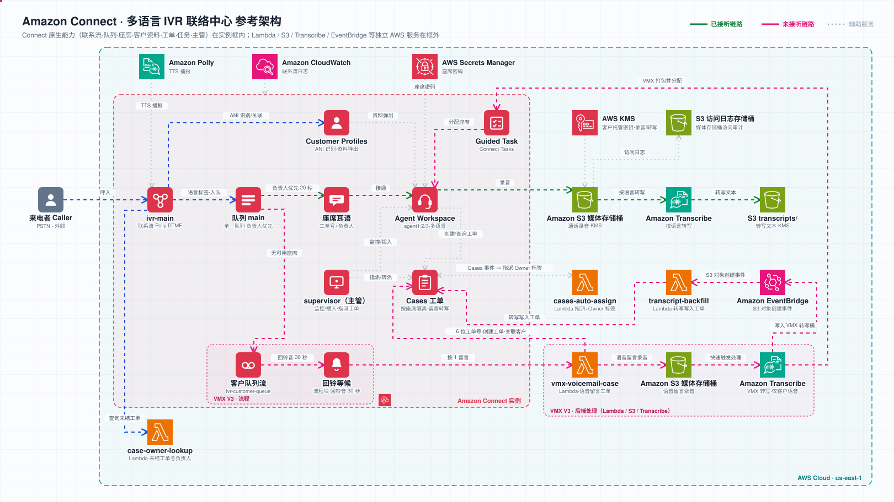
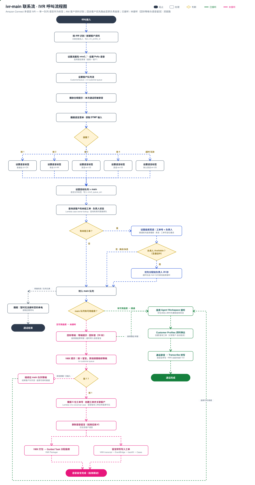

# Amazon Connect 多语言 IVR 联络中心

**🌐 Language / 语言：** [English](README.md) · **简体中文**

> 📖 **[部署与操作手册 →](docs/operations-manual.zh-CN.md)**：从部署到端到端验证的分步操作说明，含故障排查与资源清理。

本项目基于 **Amazon Connect** 构建多语言、多角色的电话联络中心，涵盖客户识别与客户资料弹出、工单管理（按座席隔离）、回访客户优先路由至原负责座席、主管监控与工单指派、语音留言工单化等能力。核心能力基于 Amazon Connect 原生功能实现，并通过 AWS Lambda 与 Voicemail Express（VMX）解决方案补充回访客户路由、工单自动指派与语音留言处理。

> **说明：** 本项目为示例代码，用于演示与评估，未针对生产环境进行加固；部署会创建计费资源（电话号码、通话分钟、转写等），使用完毕请按第 7 节删除。

呼入后，系统通过 **Amazon Polly** 播放欢迎语并提供语言选择菜单（普通话 / 粤语 / 英语 / 西班牙语）。所选语言仅作为联系人**标签**（用于确定转写语种及座席端标注），不按语言划分队列；所有呼入统一进入**单一队列 `main`**，按先到先服务原则分配。

> **语言与播报说明：** 系统播报（菜单、等候提示、语音留言提示、座席耳语）统一使用英语语音 Joanna，不随所选语言切换；所选语言用于确定 Amazon Transcribe 的转写语种，并作为座席端标注。回铃音为 450 Hz、响 1 秒停 4 秒的中国标准回铃音，如需其他制式，修改 `lambdas/cfn_connect_helper/handler.py` 中 `_ringback_wav` 的频率与节奏参数后重新部署。

- **已接听链路：** 呼叫进入 `ivr-main` 后，系统按主叫号码（ANI）在 **Amazon Connect Customer Profiles** 中匹配或新建客户资料，并与当前联系人关联。座席通过 **Agent Workspace** 接听，客户资料自动弹出，座席可为当前客户创建或查询工单（**Amazon Connect Cases**），新建工单自动指派给创建座席。通话全程录音，并按所选语言由 **Amazon Transcribe** 转写，录音与转写结果经 KMS 加密后存储于 **Amazon S3**。
- **回访客户：** 进入队列前，由 Lambda 函数 `case-owner-lookup` 查询该客户最近更新的未结工单。存在未结工单时，接听座席在通话接通前收到**座席耳语**提示（工单号与负责人）；若负责人处于 Available 状态（含通话中），该呼叫**优先分配给负责人 20 秒**，超时后由队列内其他座席接听。
- **未接听链路：** 进入队列后先播放等候提示与**回铃音（约 30 秒）**，期间如有座席空闲则直接转接；超时仍无人接听时，提示客户**按 1 留言**。留言前系统播报 **6 位唯一工单号**，并由 Lambda 函数 `vmx-voicemail-case` 创建工单、按 ANI 关联客户资料；留言录音（仅包含客户语音）由 Voicemail Express（VMX）转写，转写结果写入 VMX 转写存储桶后，由 **Amazon EventBridge** 触发 Lambda 函数 `vmx-voicemail-transcript-backfill` 将转写内容写入该工单，同时以 **Guided Task** 分配给座席跟进。
- **工单归属：** 座席仅可查看指派给本人的工单；未认领的语音留言工单对全体座席可见；未设置归属的历史工单仅主管可见。Lambda 函数 `cases-auto-assign` 订阅 Cases 事件，自动设置工单指派人并同步 `Owner` 标签，结合安全配置文件的基于标签的访问控制实现数据隔离。
- **主管功能：** 独立的 `supervisor` 用户配置主管安全配置文件，可查看**实时指标**、**监控**进行中的通话并**插入通话（Barge）**，可查看全部工单并将工单**指派或转派**给任一座席。

整套系统由 **AWS CDK 一次部署完成**（默认区域 us-east-1），部署时自动申领美国 DID 号码并关联呼入联系流。部署步骤见 [部署与操作手册](docs/operations-manual.zh-CN.md)。

## 架构



### IVR 呼叫流程

下图描述从呼入、ANI 客户识别、语言选择、回访客户路由，到已接听链路（客户资料弹出与工单）及未接听链路（回铃等候与语音留言工单化）的完整呼叫逻辑：



各链路说明：

- **客户识别（各链路的共同前提）：** `ivr-main` 首先通过 Customer Profiles 流程块，以 `_phone`（即 ANI）执行 `GetCustomerProfile`；未匹配时执行 `CreateCustomerProfile` 新建客户资料；随后执行 `AssociateContactToCustomerProfile` 将客户资料与当前联系人关联，并将 ProfileId 写入联系人属性 `vm_profile_id`。客户资料弹出、工单关联客户及回访客户路由均依赖此步骤。
- **路由（单一队列）：** 语言菜单仅设置联系人属性（`language`、`vmx3_lang`），四个语言分支均将目标队列设置为 `main`。全部多语言座席共用路由配置文件 `agent-rp`（VOICE / TASK 并发数各为 1），按座席空闲时长优先分配。
- **回访客户路由：** 设置目标队列后调用 `case-owner-lookup`，按 `vm_profile_id` 查询该客户最近更新的未结工单及负责人当前状态。存在未结工单时，设置座席耳语联系流 `agent-whisper-case-notice`（英语播报，工单号逐位播读）；负责人处于 Available 状态时，通过 `UpdateContactRoutingCriteria` 设置仅匹配负责人、20 秒后过期的路由条件，过期后恢复为队列常规分配。负责人处于离线、休息等其他状态时不等待；Lambda 调用失败时直接转入队列，不影响呼叫接通。
- **已接听通话的录音与转写：** 座席接听的通话录音存入 S3，由 Transcribe 按所选语言转写，结果存入 S3 `transcripts/` 前缀（KMS 加密）。
- **语音留言链路（未接听）：** 客户队列流 `ivr-customer-queue` 播放等候提示与回铃音（30 秒）→ 超时无人接听 → 客户按 1 留言 → `vmx-voicemail-case`（生成 6 位工单号、创建工单、按 ANI / `vm_profile_id` 关联客户资料）→ 留言录音存入 S3 → `vmx_fasttrigger` 调用 VMX 处理 → VMX 转写（仅客户语音）→ EventBridge（VMX 转写存储桶对象创建事件）→ `vmx-voicemail-transcript-backfill`（将转写写入工单）；同时以 Guided Task 分配给座席。
- **工单归属链路：** Cases 域启用 EventBridge 事件流 → 工单自动指派规则（`CASE.CREATED` / `CASE.UPDATED`）→ `cases-auto-assign`：工单创建时补全指派队列与指派人（即创建座席）；指派人变更时将 `Owner` 标签同步为新指派座席的用户名；取消指派时，语音留言工单回归共享池（`Owner=pool`），其他工单移除该标签（仅主管可见）。
- **辅助服务：** Polly 提供文本转语音（TTS，用于 `ivr-main`）；CloudWatch 收集联系流日志（Amazon Connect 实例）；Secrets Manager 存储座席密码；KMS 加密录音与转写结果（S3 媒体存储桶）；媒体存储桶的访问日志写入独立的访问日志存储桶。

---

## 1. 系统组成

全部资源由 CDK 堆栈一次创建，部署参数（实例别名、座席列表、主管、是否申领号码等）在 `cdk/cdk.json` 中配置。

| 类别 | 资源 |
|---|---|
| 加密与存储 | KMS 客户托管密钥（自动轮换）；S3 媒体存储桶（录音、转写；KMS 加密，30 天后转为标准-低频访问，7 年后过期）；S3 提示音存储桶；S3 访问日志存储桶（SSE-S3，保留 1 年） |
| Amazon Connect | 实例；录音存储与联系人记录流（Kinesis Data Streams）；营业时间 `always-open`；队列 `main` 与 `case-assignment`（供主管指派工单时列出座席，不接收联系）；路由配置文件 `agent-rp`（座席，VOICE / TASK 并发数各为 1）与 `supervisor-rp`（主管，不接收呼叫）；安全配置文件 `Agent-<用户名>`、`Agent-voicemail-pool`、`Supervisor`；座席与主管用户（密码由 Secrets Manager 生成）；快速连接；回铃音提示 `Ringback_CN_450`；联系流 `ivr-main`、`ivr-customer-queue`、`agent-whisper-case-notice`；电话号码 |
| Customer Profiles | 域 `amazon-connect-<实例别名>`（CTR 对象类型映射，按 `_phone` 去重）及与实例的集成。域名须以 `amazon-connect-` 开头，Amazon Connect 服务相关角色才有权访问该域，Agent Workspace 依赖此权限读取和编辑客户资料 |
| Cases | 域 `<实例别名>-cases`；字段"工单号""留言转写"；布局；模板"标准工单""语音留言工单"（标签传播 `Owner=pool`）与每名座席的"工单-<用户名>"（标签传播 `Owner=<用户名>`）；事件流（含 `created_by`、`assigned_user`、`assigned_queue`）；与实例的关联 |
| Lambda | 通话转写 `transcribe_trigger`；语音留言工单 `vmx_voicemail_case`；留言转写回写 `vmx_voicemail_transcript_backfill`；回访客户路由 `case_owner_lookup`；工单自动指派 `cases_auto_assign`；语音留言快速处理 `vmx_fasttrigger`；部署辅助函数 `cfn_connect_helper` |
| EventBridge | 留言转写回写（VMX 转写存储桶对象创建事件）；语音留言快速处理（媒体存储桶对象创建事件）；工单自动指派（Cases 事件） |
| Voicemail Express | 官方解决方案 **[amazon-connect/voicemail-express-amazon-connect](https://github.com/amazon-connect/voicemail-express-amazon-connect)** V3 模板，以嵌套堆栈部署；部署后自动为其处理角色授予 KMS 解密权限，并停用其默认的 Kinesis 触发方式（改由 S3 事件快速处理） |

CloudFormation 暂不支持的配置（Cases 与实例的关联、Cases 事件流、模板标签传播、快速连接关联队列、号码关联联系流、按名称查找 VMX 联系流、回铃音生成）由 CDK 自定义资源完成。

CDK 合成时由 **cdk-nag**（AwsSolutions 规则包）执行安全合规检查，存在未经评估的检查结果时合成失败；已评估并接受的检查项及其理由统一记录在 `ConnectIvrStack._acknowledge_nag_findings` 中。

---

## 2. 部署

前置条件：Node.js 20 / 22 / 24 与 AWS CDK CLI；Python 3.11 及以上版本；可执行 CDK bootstrap 并通过 CDK bootstrap 角色部署的 AWS 凭证（最小权限配置见[部署与操作手册](docs/operations-manual.zh-CN.md)第 1.1 节）。在 `cdk/cdk.json` 中设置全局唯一的 `instance_alias`，并按需修改座席列表后执行：

```bash
cd cdk
python3 -m venv .venv && . .venv/bin/activate
pip install -r requirements.txt
cdk bootstrap aws://<account-id>/us-east-1
cdk deploy
```

部署约 7–8 分钟。完成后输出呼入号码、登录网址、各用户密码在 Secrets Manager 中的 ARN 等信息。工具安装、参数说明、登录与功能验收的完整步骤见 [部署与操作手册](docs/operations-manual.zh-CN.md)。

---

## 3. 部署参数

| 参数 | 默认值 | 说明 |
|---|---|---|
| `instance_alias` | 无（必填） | Amazon Connect 实例别名，全局唯一；同时作为资源名称前缀与登录网址 |
| `agents` | agent1 / agent2 / agent3 | 座席列表（`username`、`first_name`、`last_name`），可增删 |
| `supervisor` | supervisor | 主管 |
| `stack_name` | `ConnectIvrStack` | CloudFormation 堆栈名称 |
| `region` | `us-east-1` | 部署区域 |
| `claim_phone_number` | `true` | 是否自动申领号码并关联 `ivr-main` |
| `phone_country_code` | `US` | 号码国家代码 |
| `owner_wait_seconds` | `20` | 回访客户优先分配给原负责座席的等待秒数 |
| `cases_labels` | 中文名称 | Cases 字段、布局与模板在 Agent Workspace 中的显示名称，见下方示例 |

`cases_labels` 可只填写需要修改的项，未填写的项使用默认值。改为英文显示的示例：

```json
"cases_labels": {
  "ticket_field": "Ticket number", "transcript_field": "Voicemail transcript",
  "layout": "Standard case layout", "summary_section": "Summary", "details_section": "More info",
  "standard_template": "Standard case", "voicemail_template": "Voicemail case", "agent_template_prefix": "Case - "
}
```

修改显示名称后重新部署即可，Cases 资源原地更新，已有工单不受影响。

---

## 4. 关键实现

### 4.1 单一队列路由
`ivr-main` 的四个语言分支均将目标队列设置为 `main`；座席使用路由配置文件 `agent-rp`（仅关联队列 `main`，VOICE / TASK 并发数各为 1）。语言仅作为联系人标签，用于确定转写语种及座席端标注。

### 4.2 Customer Profiles 客户识别与关联
`ivr-main` 开始执行 `GetCustomerProfile`（`_phone` = ANI）：匹配成功则执行 `AssociateContactToCustomerProfile`；未匹配则先执行 `CreateCustomerProfile` 再关联；随后通过 `UpdateContactAttributes` 写入 `vm_profile_id = $.Customer.ProfileId`。Customer Profiles 域使用 CTR 对象类型映射并按 `_phone` 去重，因此通话中新建的客户资料与通话结束后由联系人记录生成的客户资料为同一条记录。

### 4.3 工单与客户资料关联
- 座席在 Agent Workspace 中**通过 `Actions → Create Case`** 创建工单（而非通过 Cases 页签的 New Case），`Customer` 字段自动填入当前联系人关联的客户资料，工单 `customer_id` 指向该客户资料 ARN，并显示在客户资料的 Recent cases 中。
- `vmx-voicemail-case` 生成 6 位唯一工单号并创建工单，按 `vm_profile_id`（缺失时按 `_phone` 检索）将 `customer_id` 设置为**完整的客户资料 ARN**。该函数的执行角色具有 `cases:CreateCase`、`cases:SearchCases`、`cases:GetCase`、`cases:CreateRelatedItem`、`cases:TagResource`（语音留言模板在建单时写入 `Owner=pool` 标签）、`profile:SearchProfiles`、`profile:GetProfile`、`profile:GetProfileObjectType` 权限，以及对客户托管密钥（同时用于加密 Customer Profiles 域）的解密权限，均定义于 CDK 堆栈并限定到本堆栈的资源。

### 4.4 工单按座席隔离与自动指派
- **基于标签的访问控制：** 座席安全配置文件对 `Case` 资源设置 `AllowedAccessControlTags`。同一用户分配多个安全配置文件时，权限取并集，因此座席可访问本人工单（`Owner=<用户名>`）与共享池工单（`Owner=pool`）；主管安全配置文件不设标签限制。未设置 `Owner` 标签的工单（历史数据）仅主管可见。
- **创建时写入标签：** 受标签限制的座席无法创建未带标签的工单，因此每名座席使用专属模板 `工单-<用户名>`，由模板的标签传播配置在创建时写入 `Owner` 标签；语音留言工单模板写入 `Owner=pool`。
- **指派人与标签同步：** `cases-auto-assign` 处理 Cases 事件。`CASE.CREATED` 时补全 `assigned_queue`（默认为 `main`）与 `assigned_user`（取 `created_by`；由 Lambda 创建的语音留言工单无创建人，保持未指派状态）。`assigned_user` 变更时，将 `Owner` 标签更新为新指派座席的用户名；取消指派时，语音留言工单回归 `Owner=pool`，其他工单移除该标签。`assigned_user` 与 `assigned_queue` 字段值均为 ARN。已关闭的工单仅允许修改状态，需重新打开后方可转派。
- **主管指派：** 主管安全配置文件包含 `Cases.Edit` 与 `CaseTemplates.View` 权限，不包含工单创建权限。Assigned User 字段的候选列表来源于主管路由配置文件中各队列关联的用户类型快速连接。部署时为每名座席创建快速连接，并关联至队列 `main` 与队列 `case-assignment`；`case-assignment` 是 `supervisor-rp` 中唯一的队列，没有任何联系流将呼叫转入该队列，因此主管不会接到呼叫。

### 4.5 回访客户优先路由至原负责座席
- `ivr-main` 以 JSON 响应验证方式调用 `case-owner-lookup`（返回值包含对象类型字段）。该函数以 `customer_id`（由 `vm_profile_id` 构造的客户资料 ARN）与 `status=open` 为条件检索工单，按最近更新时间排序，选取首个已指派负责人的工单；返回 `has_open_case`、`open_case_ref`、`open_case_owner`、`route_to_owner`，负责人可接听时另返回 `RoutingCriteria`。
- 负责人是否可接听以 `GetCurrentUserData` 返回的状态名称为准：仅 Available 状态（含通话中或话后处理中）进入等待，其他状态（离线、休息等）直接按常规排队。等待时长由部署参数 `owner_wait_seconds` 配置，默认 20 秒。
- `ivr-main` 通过 `UpdateContactRoutingCriteria` 应用该路由条件（`AgentsCriteria` 为负责人，`Expiry` 为 20 秒），过期后自动恢复为队列常规分配。
- 存在未结工单时，通过 `UpdateContactEventHooks` 设置座席耳语联系流 `agent-whisper-case-notice`：使用 Polly 语音 Joanna 以 SSML 播报 "This caller has an open case, number xxxxxxxx, owned by xxx"，工单号通过 `say-as interpret-as="digits"` 逐位播读。由于语音通话界面不展示联系人属性，该提示采用座席耳语方式播报。

### 4.6 回铃等候后转入语音留言
客户队列流 `ivr-customer-queue`（基于 VMX `VMX3_In_Queue_Option`）在"按 1 留言"提示之前增加两个流程块：`rb-hold`（播放 "Please hold while we connect you to an agent"）与 `rb-ring`（播放回铃音提示，450 Hz、响 1 秒停 4 秒、时长约 30 秒）。期间座席接起时由 Amazon Connect 中断播放并转接，超时仍无人接听才进入语音留言。回铃音文件在部署时生成并上传至提示音存储桶。联系流定义见 `flows/customer-queue.flow.json`。

### 4.7 留言转写写入工单
语音留言由 VMX 转写，转写文件写入 VMX 转写存储桶（`vmx3-transcripts-<实例别名>`，对象键 `YYYY/MM/DD/<contactId>.json`）后，EventBridge 规则触发 `vmx-voicemail-transcript-backfill`，按联系人属性 `vm_case_id` 将转写内容写入对应工单的"留言转写"字段（多行文本）。留言录音阶段停止 IVR 录音，确保转写**仅包含客户语音**。`transcribe_trigger` 仅转写已接听通话的录音，跳过 `recordings//ivr/` 下的语音留言录音，避免重复转写。

### 4.8 语音留言任务投递时延优化
VMX 默认通过"联系人记录 → Kinesis → `RecordingProcessor`"触发处理，低话务量时任务投递通常需要 1–2 分钟。本方案改为由媒体存储桶的 EventBridge 事件触发 `vmx_fasttrigger`，由其构造 `RecordingProcessor` 所需的事件结构并直接调用，通话结束至任务投递约 15–30 秒。部署时自动停用 VMX 默认的 Kinesis 事件源映射，避免重复处理。

### 4.9 播报语音、语言与数据保留期调整
播报语音在 `ivr-main` 的 `UpdateContactTextToSpeechVoice` 流程块中配置；增加语言时在 `flows/ivr-main.flow.json` 的语言菜单中增加分支并设置对应标签（单一队列模式下无需新建队列）；S3 数据保留期在 CDK 的 `LifecycleRule` 中调整。修改后重新执行 `cdk deploy`。

---

## 5. 安全说明

- **加密：** S3 媒体存储桶中的通话录音与转写结果均使用 KMS 客户托管密钥（启用自动轮换）加密，转写任务显式指定输出加密密钥；访问日志存储桶采用 SSE-S3 加密。
- **网络访问：** 媒体存储桶与访问日志存储桶均阻止公共访问并强制使用 SSL。
- **审计：** 媒体存储桶启用服务器访问日志，写入独立的访问日志存储桶，保留 1 年。
- **合规基线：** CDK 合成阶段执行 cdk-nag AwsSolutions 规则检查，未经评估的检查结果将阻止部署；已接受的检查项逐条记录理由。
- **凭证管理：** 各用户初始密码由 Secrets Manager 随机生成，部署后可由用户或管理员在 Amazon Connect 中修改。
- **IAM 最小权限：** Lambda 函数权限按用途收敛，转写、Cases、Customer Profiles、KMS 相关权限均限定到具体资源、实例或前缀；`transcribe:StartTranscriptionJob` 不支持资源级权限，资源范围为 `*`。
- **数据访问控制：** 工单基于标签实施按座席隔离，座席仅可访问本人及共享池中的工单。
- **合规告知与数据保留：** 呼入流程开始时通过 TTS 告知通话录音；S3 对象 7 年后自动过期删除。
- **屏幕录制：** 屏幕录制不支持 macOS（仅支持 Windows / ChromeOS 及客户端应用程序），本项目未启用。
- **删除策略：** S3、KMS、Kinesis 资源的删除策略为 `DESTROY`（S3 启用 `auto_delete_objects`），执行 `cdk destroy` 会同时删除数据；生产环境应改为 `RETAIN`。

---

## 6. 跨区域部署前提

部署区域由 `cdk/cdk.json` 的 `region` 指定，默认 `us-east-1`。部署至其他区域前请确认：目标区域已完成 CDK bootstrap；该区域支持 Amazon Connect、Amazon Transcribe、Amazon Polly、Customer Profiles 与 Cases；所需语言与语音可用；实例别名全局唯一；可申领电话号码；该区域提供 VMX V3 官方模板。

---

## 7. 成本与资源清理

Amazon Connect 按通话分钟数及电话号码月租计费（美国 DID 号码约 1 美元/月），Amazon Transcribe 与 Contact Lens 按分钟计费，KMS 客户托管密钥约 1 美元/月，其余服务费用较低，无常驻计算实例费用。删除全部资源（录音、工单、客户资料等数据一并删除，号码随之释放）：

```bash
cd cdk && . .venv/bin/activate && cdk destroy
```

---

## 8. 代码结构

| 路径 | 说明 |
|---|---|
| `cdk/app.py` | CDK 应用入口：读取 `cdk.json` 部署参数，定义堆栈，启用 cdk-nag 安全检查 |
| `cdk/cdk.json` | 部署参数配置 |
| `cdk/stacks/connect_ivr_stack.py` | 全部资源定义：基础设施、Amazon Connect 配置、Customer Profiles、Cases、Lambda、EventBridge、VMX 嵌套堆栈、联系流与号码，以及 cdk-nag 接受项 |
| `flows/ivr-main.flow.json` | 呼入联系流模板：Polly 播报、DTMF 语言菜单、Customer Profiles 客户识别与关联（写入 `vm_profile_id`）、单一队列 `main` 路由、回访客户路由（未结工单查询 → 座席耳语 → 负责人优先）、接入 VMX、转接失败处理 |
| `flows/customer-queue.flow.json` | 客户队列流模板：回铃等候、语音留言提示、6 位工单号播报与留言录制（基于 VMX `VMX3_In_Queue_Option`） |
| `flows/agent-whisper-case-notice.flow.json` | 座席耳语联系流：通话接通前播报未结工单号（逐位播读）与负责人 |
| `flows/MENU-SPEC.zh-CN.md` | 联系流规格说明：呼叫逻辑、按键定义与语言属性 |
| `lambdas/case_owner_lookup/` | 回访客户路由：查询客户最近更新的未结工单及负责人状态，返回座席耳语内容与负责人优先的路由条件 |
| `lambdas/cases_auto_assign/` | 工单自动指派：由 Cases 事件触发，补全指派人与指派队列，并同步 `Owner` 标签 |
| `lambdas/vmx_voicemail_case/` | 语音留言工单：生成 6 位工单号、创建工单，并按 ANI / `vm_profile_id` 关联客户资料 |
| `lambdas/vmx_voicemail_transcript_backfill/` | 留言转写回写：由 VMX 转写存储桶的 EventBridge 事件触发，将留言转写写入对应工单 |
| `lambdas/vmx_fasttrigger/` | 由 S3 录音对象创建事件触发语音留言处理（调用 VMX `RecordingProcessor`） |
| `lambdas/transcribe_trigger/` | 由 S3 事件触发，按所选语言调用 Amazon Transcribe 转写已接听通话，转写结果使用客户托管密钥加密 |
| `lambdas/cfn_connect_helper/` | 部署辅助自定义资源：按名称查找联系流与流程模块、生成回铃音文件 |
| `tests/test_lambdas.py` | Lambda 单元测试（`python3 tests/test_lambdas.py`） |
| `docs/architecture.zh-CN.svg` | 架构图（中文） |
| `docs/ivr-flow.zh-CN.svg` | IVR 呼叫流程图（中文） |
| `docs/operations-manual.zh-CN.md` | 部署与操作手册 |

---

## 安全

如发现安全问题，请参阅 [CONTRIBUTING](CONTRIBUTING.md#security-issue-notifications) 了解报告方式。

## 许可证

本项目基于 MIT-0 许可证发布，详见 [LICENSE](LICENSE) 文件。
